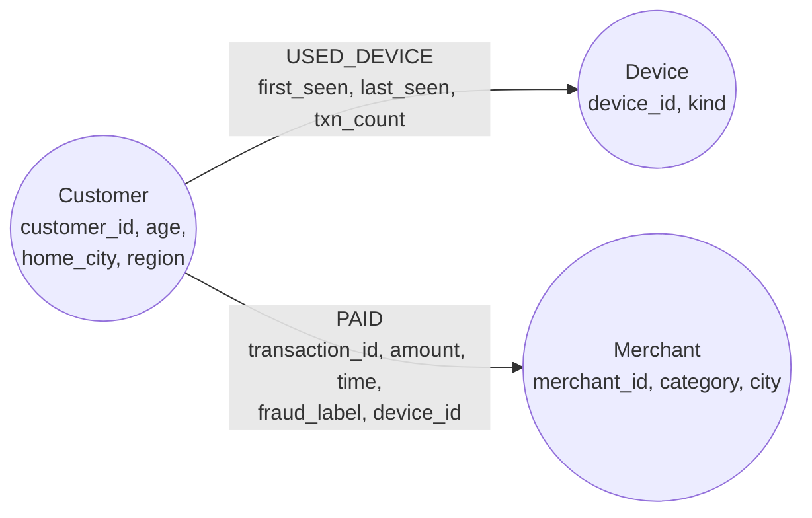
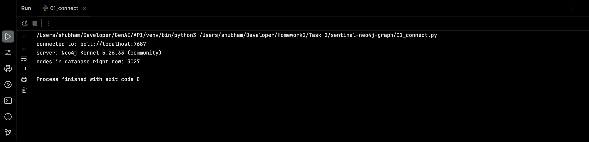

# SENTINEL fraud graph in Neo4j (Python driver)

Week task 2 - Super30. Fraud often hides in **relationships**: one device used by many customers, or a customer
who is only two hops away from a fraud-labelled payment. A table makes those links hard to see. In a graph they are one query.
This repo loads PayVista SENTINEL entities into Neo4j and finds those patterns with Cypher.

## What is in this repo

| File | What it does |
|---|---|
| `docker-compose.yml` | Runs Neo4j 5 Community locally in Docker on ports 7474 (browser) and 7687 (Bolt) |
| `.env.example` | Template for the settings. Copy it to `.env` (the real `.env` is git-ignored) |
| `config.py` | Reads settings from `.env`, creates the Neo4j driver |
| `graph_data.py` | Reads the SENTINEL kit tables and builds the rows to load (no database code) |
| `01_connect.py` | Connects with the `neo4j` driver, calls `verify_connectivity()`, prints server version and node count |
| `02_load_graph.py` | Creates uniqueness constraints and loads nodes and relationships with `MERGE` |
| `03_queries.py` | Runs the three Cypher queries and prints the cluster query for the graph view |
| `queries.cypher` | The same Cypher (Q1, Q2, Q3 and the cluster view), ready to paste into Neo4j Browser |
| `requirements.txt` | Python packages: `neo4j`, `python-dotenv`, `pandas` |
| `screenshots/` | Output of every step from my run |

Not committed (see `.gitignore`): `.env`, the instructor's `supabase_db_kit/` data and the `neo4j_data/` Docker volume.

## Setup

### 1. Get the code and install
```bash
git clone https://github.com/shubhamthanage/sentinel-neo4j-graph.git
cd sentinel-neo4j-graph
python3 -m venv .venv && source .venv/bin/activate      # Windows: .venv\Scripts\activate
pip install -r requirements.txt
```

### 2. Add your settings
```bash
cp .env.example .env
```
Then edit `.env` and set a real `NEO4J_PASSWORD` (at least 8 characters). The settings are:
```
NEO4J_URI=bolt://localhost:7687
NEO4J_USER=neo4j
NEO4J_PASSWORD=change-me-please
NEO4J_DATABASE=neo4j
DATA_DIR=supabase_db_kit/data/tables
TARGET_TXNS=5000
```
`.env` is in `.gitignore`, so passwords are never committed.

### 3. Run Neo4j (choose one)

**A. Local Docker (what I used)**
```bash
docker compose up -d
docker logs neo4j-sentinel      # wait until you see "Started."
```
Open http://localhost:7474 and log in with user `neo4j` and your password. The Python driver uses `bolt://localhost:7687`.
`docker-compose.yml` reads the password from your `.env` (`NEO4J_AUTH: neo4j/${NEO4J_PASSWORD}`), so no password is written
in any committed file. Data is kept in `./neo4j_data`.

**B. Neo4j Aura (free)**
Create an AuraDB Free instance, save the credentials it gives you (shown once), then in `.env` set
`NEO4J_URI=neo4j+s://<your-instance-id>.databases.neo4j.io` and the password. This project loads 3,027 nodes and
46,899 relationships, well inside the free limits.

### 4. Data
The data is the SENTINEL **supabase_db_kit** from the instructor (110,000 transactions, 2,500 customers, 200 merchants,
10,120 devices, all synthetic). It is the same data that `python ingest.py all` loads into Supabase; here I read its
`data/tables/*.csv.gz` files directly. Tables used: `transactions`, `labels` (holds `fraud_label`, joined on `transaction_id`),
`customers`, `devices` and `merchants`.

Unzip the kit **inside** this folder, so you have:
```
sentinel-neo4j-graph/
  supabase_db_kit/data/tables/   <- instructor's kit (git-ignored, not part of this repo)
  01_connect.py
  ...
```
Then `DATA_DIR=supabase_db_kit/data/tables` works as it is. If you keep the kit somewhere else, point `DATA_DIR` at its
`data/tables` folder.

**Sample size.** The task needs at least 5,000 transactions. `02_load_graph.py` keeps **every customer who shares a device**
with another customer first (a random sample would cut those clusters apart), then adds more customers if needed.
With the default `TARGET_TXNS=5000` this gives **856 customers, 1,971 devices, 200 merchants, 2,906 USED_DEVICE edges and
43,993 payments (477 fraud-labelled)**. Set `TARGET_TXNS=0` to load all 110,000.

## How to run
```bash
python 01_connect.py          # verify_connectivity()
python 02_load_graph.py       # constraints + MERGE load. Run it a second time: 0 new nodes, 0 new relationships
python 03_queries.py          # the three Cypher queries + the cluster query for the graph view
```
Optional: `python 02_load_graph.py --dry-run` prepares the data and prints the counts without touching Neo4j.

## Graph model



- **Customer, Device, Merchant** are nodes. Each has a uniqueness constraint on its id.
- **USED_DEVICE** links a customer to a device they have paid from, with when they first and last used it and how many payments.
- **PAID** is one payment: customer to merchant, with `amount` (rupees, from `amount_paise / 100`), `time` (a Neo4j datetime)
  and `fraud_label` (0 or 1) on the edge.
- **Why `device_id` is also on the PAID edge:** a payment connects a customer and a merchant, and the device is the context.
  Storing the device id on the edge lets us tie any payment to its device without a three-way relationship, which is what the
  "shared devices" queries need.

## MERGE, not CREATE, and constraints
Every load statement uses `MERGE`, so the same row never creates a second node or edge. Uniqueness constraints back this up:
`customer_id_unique`, `device_id_unique`, `merchant_id_unique`, and `paid_txn_unique` on `PAID.transaction_id`
(a relationship constraint, Neo4j 5.7+; on older versions the script prints a note and continues). Loads run in batches of 2,000 rows.

Run `02_load_graph.py` twice: the second run prints `new nodes: 0   new relationships: 0` for every step, the before and after
counts are the same, and it ends with `Same counts as before: running this script again created no duplicates.`

## The three questions (Cypher in `03_queries.py` and `queries.cypher`)

1. **Devices shared by 3 or more customers in 7 days.** For every payment on a device, look 7 days forward and count distinct customers.
2. **Customers within 2 hops of a fraud-labelled payment.** `fraud customer -[USED_DEVICE]-> device <-[USED_DEVICE]- other customer`.
   I follow device links only: following merchants too would reach almost everyone, because the 200 merchants are shared by all customers.
3. **Merchants most often paid from shared devices.** "Shared devices" are the devices found by question 1.

### Results from my run
These are the numbers in `screenshots/03_queries.png`. I also checked them with pandas on the same data.

**Question 1:** 8 devices, each with 3 customers inside a 7-day window. Together they carry 707 payments and 37 fraud-labelled
ones (5.2%, against 1.1% across the loaded payments and 0.6% across all 110,000).

| device_id | customers_in_7_days | payments | fraud_payments |
|---|---|---|---|
| D_c48c331b4ed19bce | 3 | 118 | 8 |
| D_4637ef8d9571a89a | 3 | 79 | 6 |
| D_fd8b0f414ced6d12 | 3 | 74 | 5 |
| D_184ed5721b197852 | 3 | 99 | 4 |
| D_89ec043739e82c62 | 3 | 91 | 4 |
| D_bbaf46afe6619750 | 3 | 109 | 4 |
| D_0c947fb45bb50e72 | 3 | 64 | 3 |
| D_cef59fb95c10c54b | 3 | 73 | 3 |

**Question 2 (top 5 of 15):**

| customer | fraud_customers_nearby | first via device |
|---|---|---|
| C_8403fb2e903349ff | 29 | D_443c9fdd18680358 |
| C_beca2cef67a57db4 | 25 | D_26be10b1819a5412 |
| C_c25537057bf5eab7 | 22 | D_39fd49b9f5ab24e8 |
| C_e5e80f775c861dae | 20 | D_39fd49b9f5ab24e8 |
| C_54f34f5ba61f0d0b | 18 | D_ac17d1f10ed3ab06 |

**Question 3:** 50 merchants receive payments from the 8 shared devices. Top 4:

| merchant | category | city | payments_from_shared_devices | shared_devices_used | fraud_payments |
|---|---|---|---|---|---|
| M_73fa75978cd80349 | electronics | Delhi | 44 | 4 | 5 |
| M_8a78374d3977a8f1 | electronics | Bengaluru | 33 | 3 | 1 |
| M_49967ebb50bb79c3 | gaming | Chennai | 31 | 3 | 3 |
| M_8094417e158fefdb | electronics | Indore | 26 | 3 | 0 |

## One suspicious cluster
`03_queries.py` prints a ready-to-paste Cypher for the top device from question 1. Paste it into Neo4j Browser (http://localhost:7474):
```cypher
MATCH (d:Device {device_id: 'D_c48c331b4ed19bce'})<-[u:USED_DEVICE]-(c:Customer)
OPTIONAL MATCH (c)-[p:PAID]->(m:Merchant) WHERE p.device_id = d.device_id
RETURN d, u, c, p, m
```
It returns 118 records (one per payment made from this device). In the Graph view that is 29 nodes (1 Device, 16 Customers, 12 Merchants) and 134 relationships (16 USED_DEVICE, 118 PAID).

**What it shows:** device `D_c48c331b4ed19bce` sits in the centre. 16 different customers have paid from it, and 3 of them inside
the same 7 days. Between them they made 118 payments to 12 merchants, and 8 of
those payments are fraud-labelled (6.8%, against 1.1% across the loaded payments). One device shared like this is a typical sign
of a mule or ring device, so the device and its customers should be reviewed together.

## Screenshots

**1. Connect** - `01_connect.py`: connected to `bolt://localhost:7687`, Neo4j Kernel 5.26.33 (community), 3,027 nodes.



**2. First load** - `02_load_graph.py` on an empty database creates 856 + 1,971 + 200 nodes and 2,906 + 43,993 relationships.


**3. Second load** - the same script again: 0 new nodes and 0 new relationships, counts unchanged.


**4. Queries** - `03_queries.py` output for Q1, Q2 and Q3.


**5. Constraints** - `SHOW CONSTRAINTS` in Neo4j Browser: three node uniqueness constraints and the `PAID` relationship constraint.


**6. Cluster graph** - Graph view of the cluster query for `D_c48c331b4ed19bce` in Neo4j Browser: the device (blue) in the centre, the 16 customers (pink) linked to it by USED_DEVICE, and the 12 merchants (orange) they paid from it. 29 nodes, 134 relationships, 118 records.


## Notes
- Timestamps are stored as Neo4j datetimes (converted from UTC ISO strings with `datetime()` inside Cypher).
- Never commit `.env`. If a password ever leaks, change it in Neo4j (or reset the Aura instance).
- All data is synthetic.
